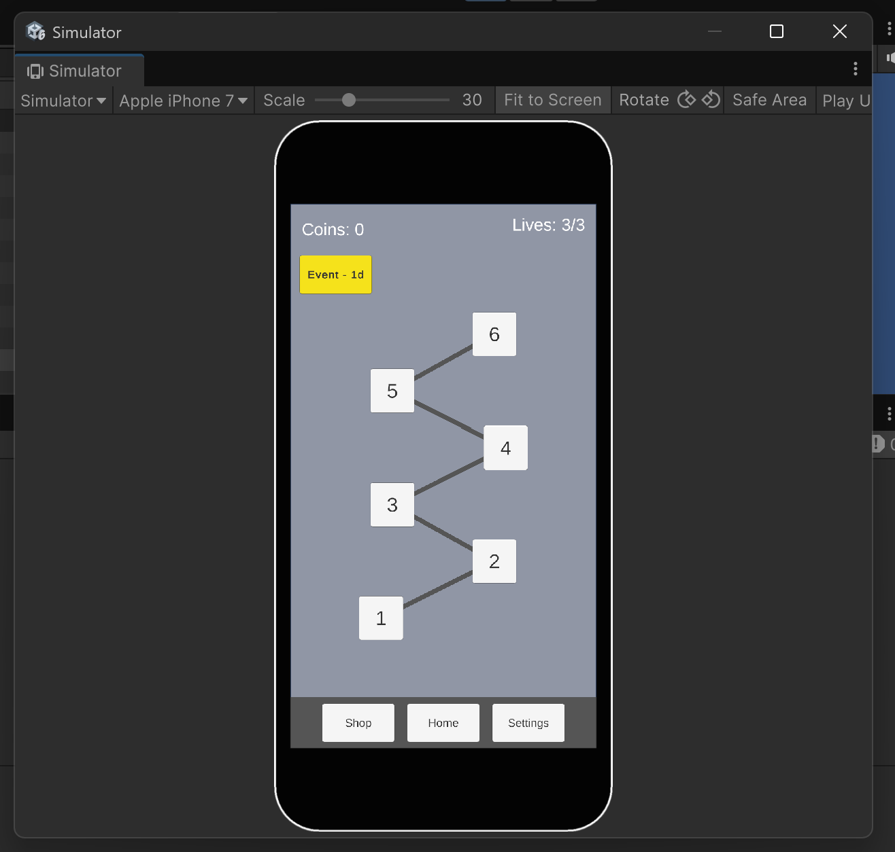
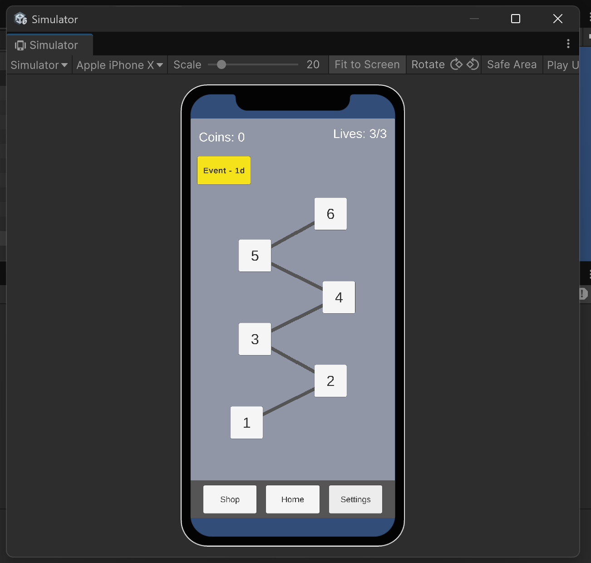

# [Super Maze]

**Team:** Lior Zahavi · Hila Yankonsky
**Course:** Mobile Game Development, Shenkar

## The game in one sentence

Race through a supermarket maze to collect your shopping list and reach the checkout before time runs out, then return to beat your time, earn three stars, and unlock the next challenge.

## How to open and build

1. Open the project in Unity 6 LTS (the exact version is on Moodle).
2. File → Build Profiles → Android → Switch Platform.
3. Build and run on an Android phone.

## Repo map

| File           | What it is                                                    |
| -------------- | ------------------------------------------------------------- |
| `pitch.md`     | One-page pitch of the game                                    |
| `DECISIONS.md` | Every real decision the team made, and why                    |
| `AGENTS.md`    | Context for AI coding tools: architecture, rules, conventions |

## Android demo

[Watch the 20-second demo: Home → Level → Home](media/android-demo.mp4)

## Device Simulator screenshots

### iPhone 7 — 16:9 display

### iPhone X — notched display

